# SkataBase

## Project Overview

SkataBase is a hardware and software project that combines skateboarding and engineering to capture, visualise and analyse skateboard tricks.

At its centre is a bespoke motion-tracking device mounted beneath a skateboard. It captures inertial measurement data and transmits it wirelessly to an Android companion app.

The long-term goal is to use machine learning to identify and classify flat-ground skateboard tricks, with session analytics and visualisations of individual tricks and overall performance.

Think Strava for skateboarding, facilitated by a purpose-built piece of hardware.

### Repositories

- [Hardware](https://github.com/edwin98thompson/SkataBase.Hardware)
- [Android app](https://github.com/edwin98thompson/SkataBase.Android)
- [Firmware](https://github.com/edwin98thompson/SkataBase.Firmware)

### Project Status

The current prototype streams motion data from an ESP32-C6 and ICM-20948 to an Android app. The app visualises board orientation and supports session recording and manual trick annotation. A custom PCB is in development; automated trick classification and session analytics remain future work.

## Project Origins

The idea for SkataBase came to me while studying robotics as an undergraduate. I was skateboarding regularly and becoming interested in machine learning and its potential applications.

Exploring the idea led me to academic papers on classifying skateboard tricks from inertial sensor data. One particularly relevant paper is:

[IMU-based Trick Classification in Skateboarding](https://www5.cs.fau.de/Forschung/Publikationen/2015/Groh15-ITC.pdf)

As low-cost microcontrollers, inertial measurement units (IMUs) and embedded development platforms became more accessible, I realised the concept was technically feasible.

I decided to turn the idea into a practical engineering project, bringing together embedded systems, sensor fusion, mobile application development, mechanical design and machine learning.

## System Overview

SkataBase combines hardware and software to capture skateboard motion, process inertial sensor data and turn it into information about tricks and skateboarding sessions.

An embedded motion-tracking device mounted beneath the skateboard communicates wirelessly with the Android companion app.

### System Architecture

The data flow runs from the skateboard-mounted sensor to the Android app. Classification and analytics are planned additions:

```text
ICM-20948 IMU -> ESP32-C6 firmware -> Bluetooth Low Energy -> Android app
  motion data    orientation and       sensor data          live view,
                 packet handling                            recording and
                                                            annotation
                                                              |
                                                              v
                                               Planned: classification
                                               and session analytics
```

### Embedded System & Firmware

The embedded system captures and processes skateboard motion data.

An ESP32-C6 microcontroller interfaces with an ICM-20948 nine-axis inertial measurement unit over SPI. The IMU provides accelerometer, gyroscope and magnetometer measurements, which are used to estimate the orientation and movement of the skateboard.

The firmware configures and calibrates the sensor, acquires data in real time, estimates orientation with a Madgwick sensor-fusion filter and handles BLE communication.

Sensor measurements and orientation data are encoded in structured packets and sent to the Android app over BLE.

### Android Application

The Android app is the main interface for the motion-tracking device.

It connects to the embedded system over Bluetooth Low Energy (BLE), processes incoming sensor data and displays the skateboard's orientation in 3D in real time.

It also supports session recording and manual trick annotation, so labelled motion data can be collected during skateboarding sessions.

Automated trick classification, session analytics and performance visualisations are planned future features.

### Custom Hardware

A custom PCB is in development to consolidate the embedded system into a compact, purpose-built board.

The design brings together the ESP32-C6 microcontroller, IMU interface, battery connection and supporting electronics. It also accounts for power management, size and manufacturability.

### Mechanical Design & Enclosure

A bespoke enclosure is being designed in CAD for 3D printing.

It will protect the electronics and provide a compact, secure skateboard mount, with attention to vibration, impact resistance and access to the device.

## Current Development Status

SkataBase is in the prototyping and hardware development phase. The initial proof of concept demonstrated motion tracking, wireless data transmission and preliminary skateboard-trick event detection.

The checklist below summarises completed work and remaining development objectives.

### Embedded System & Firmware

- [x] ESP32-C6 embedded development platform established.
- [x] ICM-20948 IMU integration over SPI.
- [x] Accelerometer, gyroscope and magnetometer data acquisition.
- [x] Sensor calibration and bias compensation.
- [x] Madgwick sensor fusion for orientation estimation.
- [x] Real-time roll, pitch and yaw estimation.
- [x] BLE communication and structured sensor data transmission.
- [ ] Improved magnetometer calibration.
- [ ] Stationary detection and periodic sensor bias correction.
- [ ] Automatic BLE reconnection and connection management.
- [ ] Low-power operation and battery management.

### Android Application

- [x] Kotlin Android application established using Jetpack Compose.
- [x] BLE device discovery and connection.
- [x] Incoming sensor packet reception and decoding.
- [x] Real-time orientation data processing.
- [x] 3D skateboard orientation visualisation.
- [x] Session data collection and recording.
- [x] Manual trick annotation and data labelling.
- [ ] Improved session management and data export.
- [ ] Enhanced trick visualisation and playback.
- [ ] Automated trick classification integration.
- [ ] Session analytics and performance statistics.

### Hardware Development

- [x] Initial breadboard prototype assembled and operational.
- [x] SPI communication validated between ESP32 and IMU.
- [x] Initial skateboard-mounted prototype constructed.
- [x] Successful preliminary skateboard field testing.
- [x] Initial custom PCB schematic and layout developed in KiCad.
- [ ] PCB design finalisation and design rule verification.
- [ ] Custom PCB fabrication and assembly.
- [ ] Battery power management and charging integration.
- [ ] Physical enclosure design and 3D printing.
- [ ] Mechanical integration and skateboard mounting validation.

### Data Collection & Machine Learning

- [x] Initial motion data collection workflow established.
- [x] Manual trick annotation workflow implemented.
- [x] Preliminary motion-based trick event detection.
- [ ] Larger labelled skateboard motion dataset.
- [ ] Data preprocessing and feature extraction pipeline.
- [ ] Evaluation of suitable machine learning approaches.
- [ ] Initial trick classification model.
- [ ] Model evaluation across different tricks and skateboarding conditions.
- [ ] Integration of automated classification into the Android application.

### Project Infrastructure

- [x] Separate Android, firmware and hardware repositories established.
- [x] GitHub project hub established.
- [x] Individual repository documentation and READMEs created.
- [ ] Consolidated project documentation and development roadmap.
- [ ] Release and versioning strategy.


## Application Showcase

The SkataBase Android application provides the primary interface for interacting with the motion-tracking device, visualising skateboard movement and collecting motion data.

Developed using Kotlin and Jetpack Compose, the application communicates with the embedded system over Bluetooth Low Energy (BLE).

### Device Connectivity

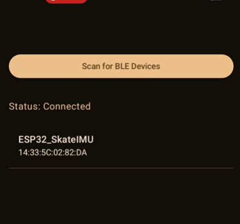

Discovery and connection to the skateboard-mounted motion-tracking device.

### Live Motion Visualisation

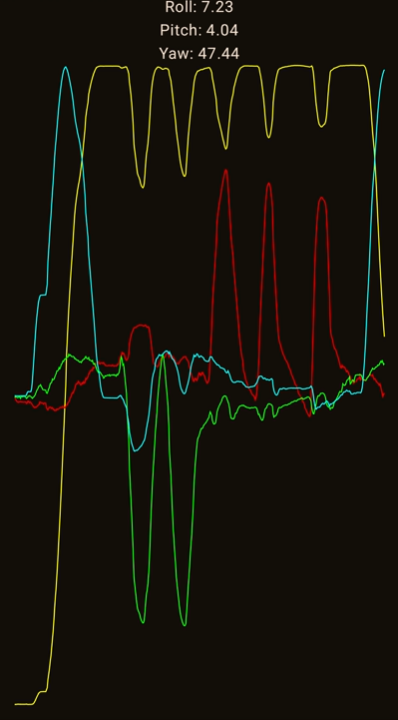
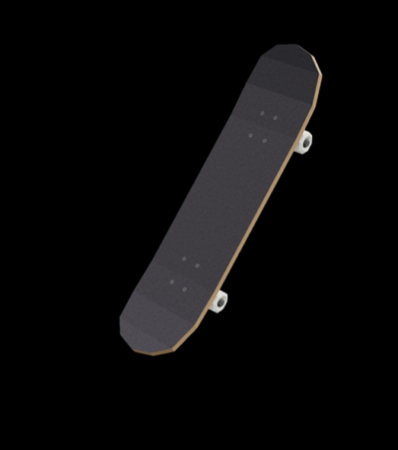

Real-time visualisation of skateboard orientation using incoming IMU data.

### Session Recording & Data Collection

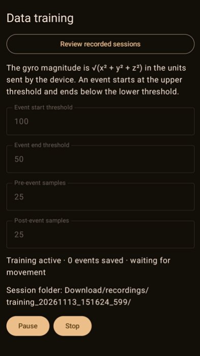
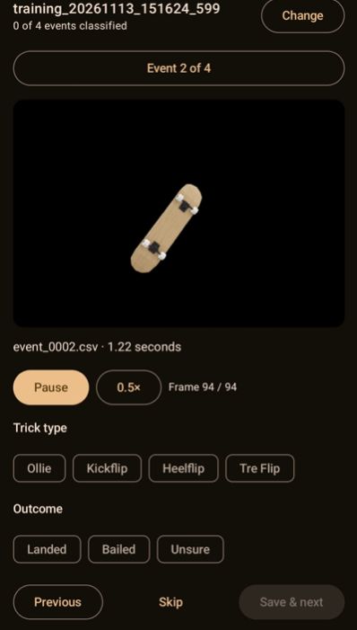

Recording skateboarding sessions and collecting motion data for subsequent analysis and annotation.

### Future Analytics

Planned work includes evaluating classification approaches, training a model and integrating it into the app. The app could report a predicted trick with a confidence score, alongside trick tracking and session analytics. The model architecture has not yet been selected.

## Hardware Journey

The hardware has progressed through several prototypes used to develop and test the application. Further refinements are underway.

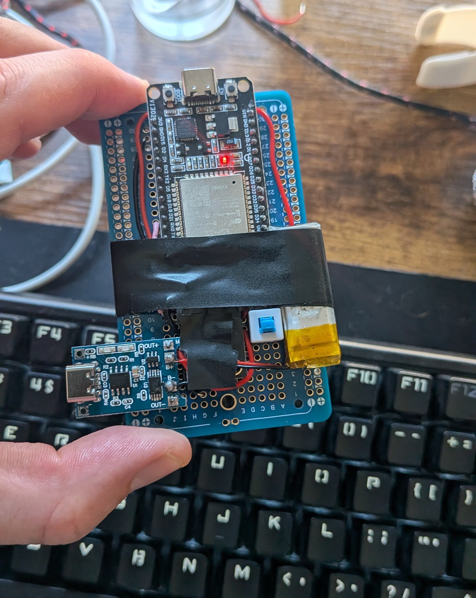

The first iteration used an ESP32 DevKit, an ICM-20948 IMU, a TP4056 charging module and a salvaged LiPo battery. Electrical tape held the early assembly together.

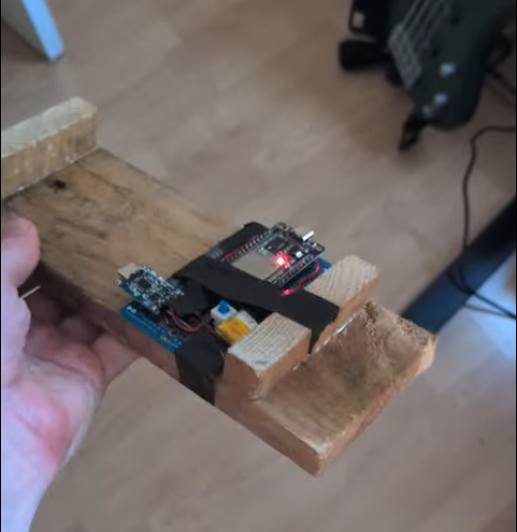

I made a small wooden platform from salvaged pallet wood to resemble a skateboard.

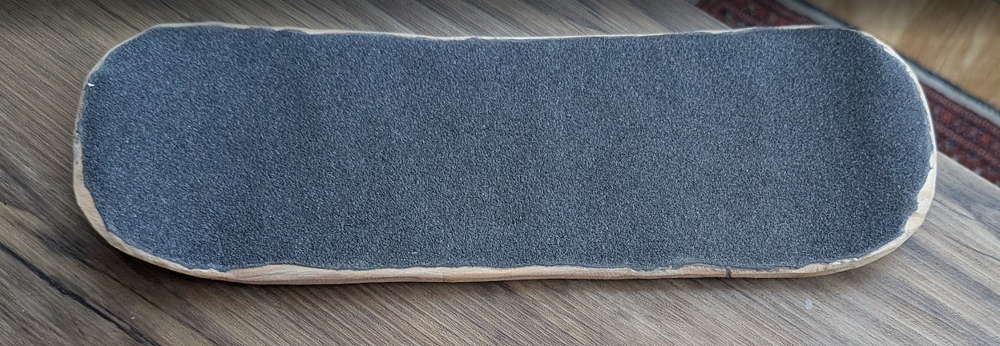

I extended the mini-skateboard idea by grinding another piece of pallet wood into a rough concave shape and covering it with skateboard grip tape. Building it was a welcome break from computer work and gave me a useful platform for demos and desk development.

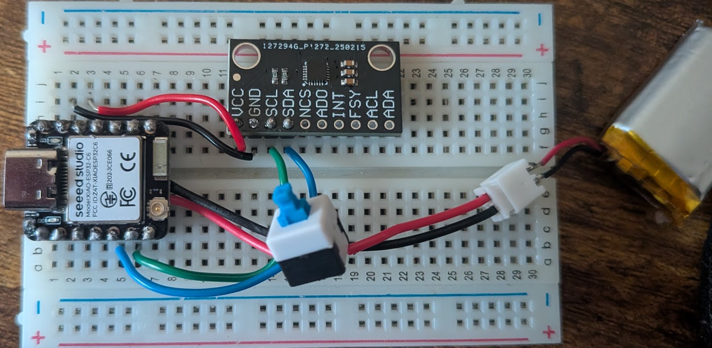

For the next prototype, I chose the Seeed Studio XIAO ESP32-C6 for its smaller footprint, which suits the project's modest GPIO requirements. Its onboard battery charging means the LiPo connects directly to the board and charges over USB-C, removing the need for a separate TP4056 charging module. A latching push button is wired in series with the battery supply.

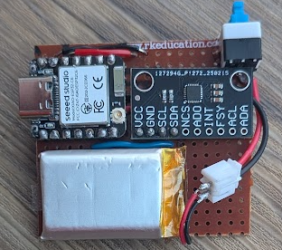

This is the second prototype PCB, before the layout was reduced in size.

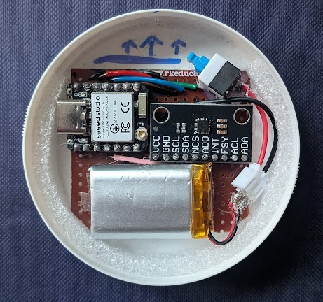

I used a repurposed container to house the prototype PCB. The wiring differs from the previous version because I switched from I2C to SPI after finding it more robust in testing.

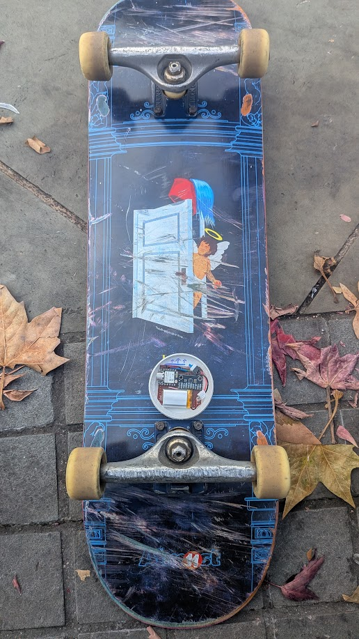

The prototype sensor is attached beneath the skateboard with hook-and-loop tape. The lid was on while riding. The mount often failed during flip tricks, limiting the data collected after the first session. This showed that the mounting method needed to be improved before further field testing.


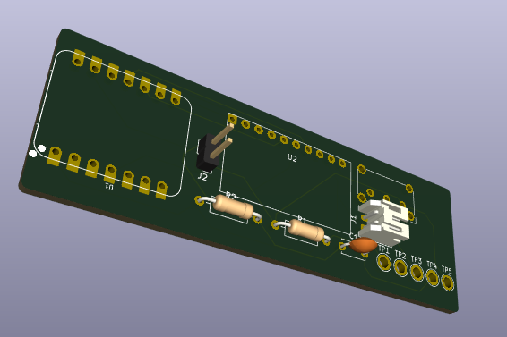

Current work focuses on the PCB and enclosure designs. The schematic and layout are being developed in KiCad; an initial design is complete and will be refined before fabrication. Enclosure design is progressing in parallel using 3D CAD.

